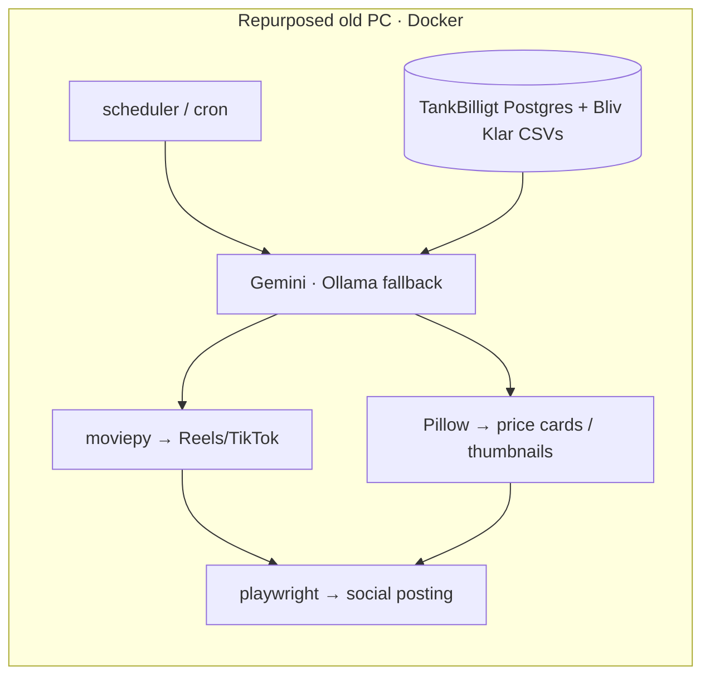

# Marketing Agent ♻️🤖

**An autonomous marketing pipeline that gives old computers a second life.** A containerized AI agent that turns your own app data into social content — videos, price cards, posts — and publishes it, running entirely on repurposed hardware.

> **Status:** idea build. The point of the project is **sustainability + self-hosting** — take a retired laptop/desktop, drop a Docker container on it, and let it quietly run your marketing while you sleep.

## Concept
- **The brain** — Gemini for generation, with a **local Ollama (Llama 3)** fallback so it keeps working offline / for free
- **The visuals** — `moviepy` auto-edits Reels/TikToks; `Pillow` renders thumbnails and fuel price-cards
- **The hands** — `playwright` automates posting to social platforms
- **The data** — pulls live numbers from the **TankBilligt** PostgreSQL DB and **Bliv Klar** question CSVs to make content that's actually relevant

## Architecture

## Why it's a good signal
- **Pragmatic self-hosting** — Dockerized, deploy-by-git-to-server, designed to squeeze useful work out of hardware that would otherwise be e-waste.
- **Hybrid AI** — cloud model with a local fallback for cost/resilience.
- **End-to-end automation** — data → generation → media → publishing, unattended.

## Tech stack
Python · Docker · google-genai (Gemini) · Ollama · moviepy · Pillow · Playwright · psycopg2 / PostgreSQL · pandas · schedule

---
© 2026 Alen Trgovcevic. Concept build; source private.
